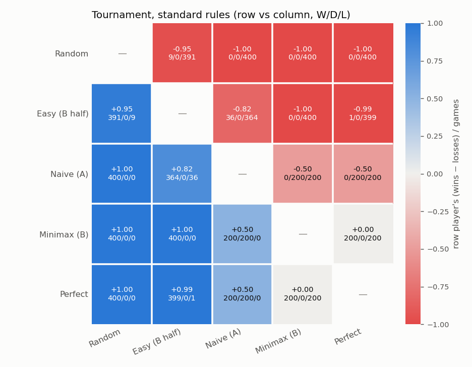
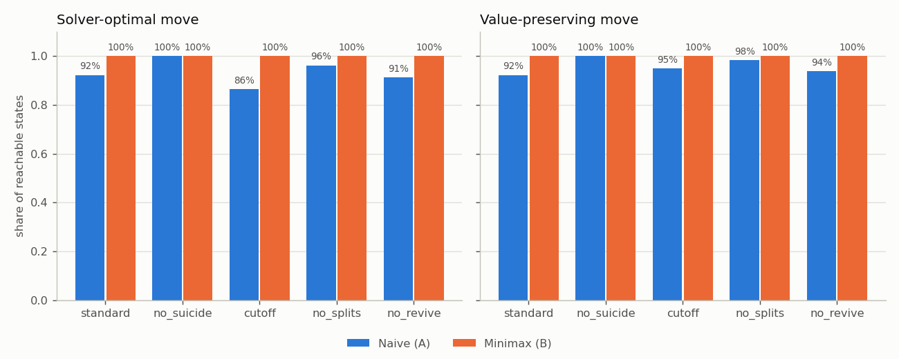
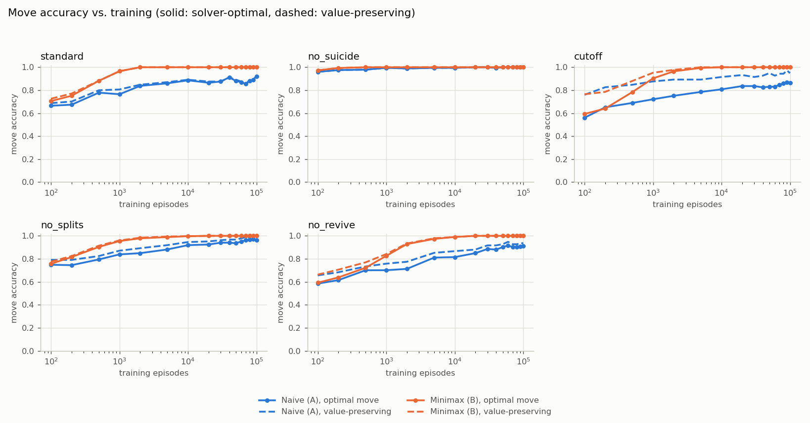

# Chopsticks AI

An exact solver for the hand game Chopsticks, two tabular Q-learning agents, a
measurement of how close the agents get to perfect play, and a browser version
with five difficulty levels.



## The game

Two players, two hands each, every hand starting with one finger. On your turn
you do exactly one of:

- **Attack.** Tap one of the opponent's live hands with one of yours. Their hand
  gains as many fingers as yours has; yours doesn't change. Under the default
  *cutoff* rule a hand that reaches 5 or more fingers is dead (0).
- **Split.** Redistribute your own fingers between your two hands (0–4 each).
  The result must be a different position; just swapping hands doesn't count.
  - **Reviving:** a dead hand isn't gone for good. Splitting fingers onto it
    brings it back: (0,2) → (1,1), (0,3) → (1,2), (0,4) → (1,3) or (2,2).
  - **Suicide splits:** you may put everything on one hand and leave the other
    dead: (1,1) → (0,2), (1,3) → (0,4), (2,2) → (0,4).

A dead hand can't attack or be attacked. Lose both hands and you lose. A game
that reaches 200 moves is a draw.

### Rule presets

| Preset | What changes |
|---|---|
| `standard` | Defaults: cutoff at 5, splits, revives and suicide splits allowed |
| `no_suicide` | A split may not leave a hand at 0 (revives still allowed) |
| `rollover` | A hand wraps around mod 5 instead of dying at 5+ (exactly 5 is still dead) |
| `no_splits` | Attacks only |
| `no_revive` | Dead hands stay dead; splits only when both hands are alive |

All of these are fields of the `Rules` dataclass in
[chopsticks/rules.py](chopsticks/rules.py), along with `even_splits_only` and
`max_moves`.

## Running it

Needs Python 3.10+ and, for the engine cross-check test, Node.js.

```bash
python -m venv .venv
.venv/Scripts/activate            # Windows; on macOS/Linux: source .venv/bin/activate
pip install -r requirements.txt

python -m chopsticks all          # solve -> train -> evaluate -> export (about 3 minutes)
pytest                            # 92 tests

python -m http.server             # then open http://localhost:8000/web/
```

Individual steps:

```bash
python -m chopsticks solve [--preset standard]
python -m chopsticks train --agent {naive,minimax,all} --preset {standard,...,all} [--episodes N --gamma G --seed S]
python -m chopsticks ablation     # Minimax B retrained with gamma = 1.0, for comparison
python -m chopsticks evaluate     # writes results/results.md and the charts
python -m chopsticks export       # writes web/data/*.json
```

Trained Q-tables and checkpoints go to `models/` (git-ignored, regenerated by
`all`). The web game only needs `web/data/`, which is committed.

## How it works

| Module | What it does |
|---|---|
| [game.py](chopsticks/game.py) | State = (mover's hands, opponent's hands), each sorted so mirror images are one state. Legal moves, deduplicated by resulting state. |
| [solver.py](chopsticks/solver.py) | Retrograde analysis: label terminal states LOSS, then work backwards (a state is WIN if some move reaches an opponent LOSS, LOSS if every move reaches an opponent WIN, and DRAW if it's never labelled). Records distance to the result, so Perfect wins as fast as possible and loses as slowly as possible. The game graph has cycles, so plain recursive minimax doesn't work here. |
| [qlearn.py](chopsticks/qlearn.py) | Agent A (*naive*) learns against a uniform-random opponent with the standard Q-learning target. Agent B (*minimax*) plays itself with one shared table and a negamax target, `−γ · max Q(s′)`, because the next turn is the opponent's. Exploration is epsilon-greedy, decaying from 1.0 to 0.05 over the first 80% of training, with 100,000 episodes per agent and checkpoints along the way. |
| [evaluate.py](chopsticks/evaluate.py) | Scores agents against the solver and runs the tournaments and charts. |
| [export.py](chopsticks/export.py) | Writes the solver tables, greedy policies and engine fixtures to JSON. |
| [web/](web/) | Plain HTML/CSS/JS with no build step. [engine.js](web/engine.js) is a port of `game.py`, and [engine.test.mjs](web/engine.test.mjs) checks that it matches Python's moves and next states on every reachable state. `pytest` runs it. |

## Results

Full tables are in [results/results.md](results/results.md).

### What the solver says

| Preset | Reachable states | WIN / LOSS / DRAW | Starting position, first player |
|---|---:|---|---|
| standard | 191 | 120 / 61 / 10 | **LOSS** (second player wins within 26 plies) |
| no_suicide | 171 | 42 / 18 / 111 | **DRAW** |
| rollover | 207 | 72 / 35 / 100 | **DRAW** |
| no_splits | 92 | 57 / 35 / 0 | **LOSS** in 8 plies |
| no_revive | 166 | 110 / 56 / 0 | **LOSS** in 10 plies |

**Whether suicide splits are allowed decides the game.** With them (standard
rules), the second player can force a win. Ban them and, with perfect play,
nobody can win. Drawn positions go from 10 to 111, because suicide splits are
the tool that breaks the defensive cycles.

### How the agents compare



"Optimal move" means the agent's move is one of the solver's best moves.
"Value-preserving" means the move keeps the game-theoretic result: it doesn't
throw away a win or a draw.

- **Minimax (B) learns the game.** It plays a solver-optimal move in 100% of
  reachable states in four presets, and 98.8% in no_suicide (where every miss
  still keeps the game's result). Its value estimates match the solver's WIN/LOSS/DRAW
  verdict in 100% of states. In the tournament it is indistinguishable from
  Perfect: under standard rules each wins every game in which it moves second.
- **Naive (A) learns to beat Random, not to play well.** It wins 400/400
  against Random in three presets, but under standard rules only 86% of its
  moves are optimal. Under standard rules it never beats Perfect: of 400 games
  it loses 200 and draws 200, even though the second player can always force a
  win.
  Under rollover, where the start is a draw, it loses 396 of 400 to Perfect.
  Its Q-values describe "winning against a random player," so they agree with
  the solver's verdict in only 27–68% of states in presets with draws. That is
  what you expected, and it is what happened.
- **Easy (half-trained B)** is the earliest checkpoint with half of B's final
  skill (100–1,000 episodes depending on the preset). It beats Random in
  94–100% of games, but under standard, no_suicide and rollover rules it loses
  most games to Naive (364, 400 and 245 of 400).
- In `no_splits` and `no_revive` the game is short and the first player loses
  regardless, so all trained agents tie 200/200 with each other. There isn't
  much room to be better there.
- Against Random, Perfect isn't the best scorer. In a lost position Perfect
  plays the *slowest* loss against a perfect opponent rather than gambling on
  Random's mistakes, and it loses 31 of 400 to Random in no_splits.



### One departure from the spec: γ = 0.95, not 1.0

With γ = 1, a win in 3 moves and a win in 30 are both worth +1, so Agent B had
no reason to finish games. It kept every won position (value-preserving stayed
at 100%), but under standard rules only 74% of its moves were solver-optimal.
Against Perfect it drew 161 of the 200 games it should have won, by circling
until the 200-move cap. Discounting with γ = 0.95 makes faster wins worth more,
which is exactly what the solver's distance-to-result encodes, and B then
reaches 100%. `python -m chopsticks all` also retrains B with γ = 1.0, and
results.md shows the side-by-side comparison.

## The web game

- Click one of your hands, then one of the computer's, to attack. Dead hands
  stay on the table, greyed out with a dashed outline, until you revive them.
- **Split** lists the legal splits, labeled by type: "Revive: (0,3) → (1,2)",
  "Suicide split: (1,1) → (0,2)". The button is disabled when no split is legal.
- **Hint** shows the solver's verdict ("You can force a win in 3 moves") and
  outlines an optimal move.
- **Undo** takes back your last move and the computer's reply.
- Difficulty: Random, Easy (half-trained B), Medium (Naive A), Hard (Minimax B),
  Perfect (solver). Rules preset and who moves first are also selectable.

## Tests

`pytest` covers:
- the full split table and every rule variant;
- that swap-only splits are rejected;
- attacks under cutoff and rollover;
- canonicalization;
- solver positions checked by hand, plus a check that every state's label is a
  consistent fixed point, and an independent depth-limited search that
  reproduces every distance;
- the Q-update math on toy examples;
- reproducibility of training under a fixed seed;
- the Python ↔ JS engine cross-check.
