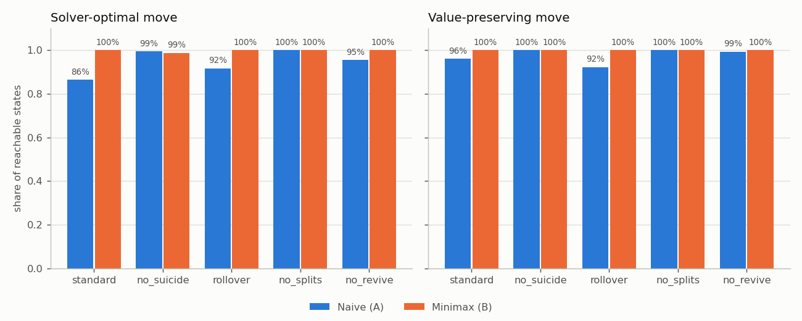

# Chopsticks AI — results

Generated by `python -m chopsticks all`. All numbers come from fixed seeds.

## Solver

| Preset | Rules | Reachable states | WIN | LOSS | DRAW | Start position (first player) |
|---|---|---:|---:|---:|---:|---|
| standard | Cutoff at 5, splits allowed, revives and suicide splits allowed. | 191 | 120 | 61 | 10 | LOSS in 26 plies |
| no_suicide | Like standard, but a split may not leave a hand at 0. | 171 | 42 | 18 | 111 | DRAW |
| rollover | Like standard, but a hand wraps around mod 5 (exactly 5 is dead). | 207 | 72 | 35 | 100 | DRAW |
| no_splits | Attacks only; no splits at all. | 92 | 57 | 35 | 0 | LOSS in 8 plies |
| no_revive | Dead hands stay dead; splits only when both hands are alive. | 166 | 110 | 56 | 0 | LOSS in 10 plies |

Distances are in plies (single moves by either player). The solver ignores the move cap, so DRAW means neither side can force a result.

## What we found

- **Suicide splits decide the game.** Under standard rules the starting position is a LOSS for the first player (the second player forces a win within 26 plies). Banning suicide splits makes it a DRAW.
- **rollover**: start is DRAW for the first player.
- **no_splits**: start is LOSS for the first player in 8 plies.
- **no_revive**: start is LOSS for the first player in 10 plies.
- **Accuracy (mean over presets).** Naive (A): 94.6% optimal, 97.5% value-preserving, 65.3% value agreement. Minimax (B): 99.8% optimal, 100.0% value-preserving, 100.0% value agreement.
- **standard tournament** (W/D/L): A vs Random 400/0/0, B vs Random 400/0/0, A vs Perfect 0/200/200, B vs Perfect 200/0/200.
- **no_suicide tournament** (W/D/L): A vs Random 400/0/0, B vs Random 400/0/0, A vs Perfect 0/400/0, B vs Perfect 0/400/0.
- **rollover tournament** (W/D/L): A vs Random 400/0/0, B vs Random 400/0/0, A vs Perfect 0/4/396, B vs Perfect 0/400/0.
- **no_splits tournament** (W/D/L): A vs Random 380/0/20, B vs Random 372/0/28, A vs Perfect 200/0/200, B vs Perfect 200/0/200.
- **no_revive tournament** (W/D/L): A vs Random 394/0/6, B vs Random 400/0/0, A vs Perfect 200/0/200, B vs Perfect 200/0/200.

## Agent accuracy vs. the solver

*Optimal move*: the greedy move is one of the solver's optimal moves (fastest win / slowest loss). *Value-preserving*: the move keeps the game-theoretic result (any winning move from a WIN, any drawing move from a DRAW). Ties between equal Q-values count fractionally. *Weighted* versions weight each state by how often it came up in the agent's games against Random and against Perfect. *Value agreement*: sign of max Q (|Q| < 0.05 = draw) matches the solver.

| Preset | Agent | Optimal move | Value-preserving | Optimal (weighted) | Value-preserving (weighted) | Value agreement |
|---|---|---:|---:|---:|---:|---:|
| standard | Naive (A) | 86.4% | 96.0% | 75.8% | 99.7% | 68.4% |
| standard | Minimax (B) | 100.0% | 100.0% | 100.0% | 100.0% | 100.0% |
| no_suicide | Naive (A) | 99.4% | 100.0% | 100.0% | 100.0% | 27.5% |
| no_suicide | Minimax (B) | 98.8% | 100.0% | 100.0% | 100.0% | 100.0% |
| rollover | Naive (A) | 91.7% | 92.2% | 94.8% | 95.8% | 38.3% |
| rollover | Minimax (B) | 100.0% | 100.0% | 100.0% | 100.0% | 100.0% |
| no_splits | Naive (A) | 100.0% | 100.0% | 100.0% | 100.0% | 97.6% |
| no_splits | Minimax (B) | 100.0% | 100.0% | 100.0% | 100.0% | 100.0% |
| no_revive | Naive (A) | 95.4% | 99.3% | 100.0% | 100.0% | 94.8% |
| no_revive | Minimax (B) | 100.0% | 100.0% | 100.0% | 100.0% | 100.0% |

## Learning curves

## Why γ < 1: Minimax (B) at γ = 1.0

With γ = 1 a win in 3 and a win in 30 are both worth +1, so the agent has no reason to finish. It keeps every winning position (value-preserving stays at 100%) but can circle among them until the move cap declares a draw. Discounting (γ = 0.95) makes faster wins worth more, which is what the solver's distance-to-result encodes.

| Preset | γ | Optimal move | Value-preserving | vs Perfect (W/D/L) | vs Random (W/D/L) |
|---|---:|---:|---:|---:|---:|
| standard | 0.95 | 100.0% | 100.0% | 200/0/200 | 400/0/0 |
| standard | 1.0 | 74.0% | 100.0% | 39/161/200 | 362/0/38 |
| no_suicide | 0.95 | 98.8% | 100.0% | 0/400/0 | 400/0/0 |
| no_suicide | 1.0 | 97.4% | 100.0% | 0/400/0 | 400/0/0 |
| rollover | 0.95 | 100.0% | 100.0% | 0/400/0 | 400/0/0 |
| rollover | 1.0 | 98.4% | 100.0% | 0/400/0 | 400/0/0 |
| no_splits | 0.95 | 100.0% | 100.0% | 200/0/200 | 372/0/28 |
| no_splits | 1.0 | 94.6% | 100.0% | 200/0/200 | 367/0/33 |
| no_revive | 0.95 | 100.0% | 100.0% | 200/0/200 | 400/0/0 |
| no_revive | 1.0 | 87.9% | 100.0% | 200/0/200 | 298/0/102 |

## Tournaments

Each pairing plays the listed number of games, alternating who moves first. Cells are the row player's wins/draws/losses. Easy = the earliest Minimax (B) checkpoint whose optimal-move accuracy is at least halfway between an untrained table and the finished agent.

### standard (400 games per pairing; Easy = 500 of 100,000 episodes)

| row vs column | Random | Easy (B half) | Naive (A) | Minimax (B) | Perfect |
|---|---:|---:|---:|---:|---:|
| **Random** | — | 9/0/391 | 0/0/400 | 0/0/400 | 0/0/400 |
| **Easy (B half)** | 391/0/9 | — | 36/0/364 | 0/0/400 | 1/0/399 |
| **Naive (A)** | 400/0/0 | 364/0/36 | — | 0/200/200 | 0/200/200 |
| **Minimax (B)** | 400/0/0 | 400/0/0 | 200/200/0 | — | 200/0/200 |
| **Perfect** | 400/0/0 | 399/0/1 | 200/200/0 | 200/0/200 | — |

### no_suicide (400 games per pairing; Easy = 100 of 100,000 episodes)

| row vs column | Random | Easy (B half) | Naive (A) | Minimax (B) | Perfect |
|---|---:|---:|---:|---:|---:|
| **Random** | — | 22/0/378 | 0/0/400 | 0/0/400 | 0/0/400 |
| **Easy (B half)** | 378/0/22 | — | 0/0/400 | 0/0/400 | 0/0/400 |
| **Naive (A)** | 400/0/0 | 400/0/0 | — | 0/400/0 | 0/400/0 |
| **Minimax (B)** | 400/0/0 | 400/0/0 | 0/400/0 | — | 0/400/0 |
| **Perfect** | 400/0/0 | 400/0/0 | 0/400/0 | 0/400/0 | — |

### rollover (400 games per pairing; Easy = 500 of 100,000 episodes)

| row vs column | Random | Easy (B half) | Naive (A) | Minimax (B) | Perfect |
|---|---:|---:|---:|---:|---:|
| **Random** | — | 0/0/400 | 0/0/400 | 0/0/400 | 0/0/400 |
| **Easy (B half)** | 400/0/0 | — | 155/0/245 | 0/0/400 | 0/0/400 |
| **Naive (A)** | 400/0/0 | 245/0/155 | — | 0/1/399 | 0/4/396 |
| **Minimax (B)** | 400/0/0 | 400/0/0 | 399/1/0 | — | 0/400/0 |
| **Perfect** | 400/0/0 | 400/0/0 | 396/4/0 | 0/400/0 | — |

### no_splits (400 games per pairing; Easy = 100 of 100,000 episodes)

| row vs column | Random | Easy (B half) | Naive (A) | Minimax (B) | Perfect |
|---|---:|---:|---:|---:|---:|
| **Random** | — | 23/0/377 | 20/0/380 | 28/0/372 | 31/0/369 |
| **Easy (B half)** | 377/0/23 | — | 200/0/200 | 200/0/200 | 200/0/200 |
| **Naive (A)** | 380/0/20 | 200/0/200 | — | 200/0/200 | 200/0/200 |
| **Minimax (B)** | 372/0/28 | 200/0/200 | 200/0/200 | — | 200/0/200 |
| **Perfect** | 369/0/31 | 200/0/200 | 200/0/200 | 200/0/200 | — |

### no_revive (400 games per pairing; Easy = 1,000 of 100,000 episodes)

| row vs column | Random | Easy (B half) | Naive (A) | Minimax (B) | Perfect |
|---|---:|---:|---:|---:|---:|
| **Random** | — | 14/0/386 | 6/0/394 | 0/0/400 | 5/0/395 |
| **Easy (B half)** | 386/0/14 | — | 200/0/200 | 200/0/200 | 200/0/200 |
| **Naive (A)** | 394/0/6 | 200/0/200 | — | 200/0/200 | 200/0/200 |
| **Minimax (B)** | 400/0/0 | 200/0/200 | 200/0/200 | — | 200/0/200 |
| **Perfect** | 395/0/5 | 200/0/200 | 200/0/200 | 200/0/200 | — |
