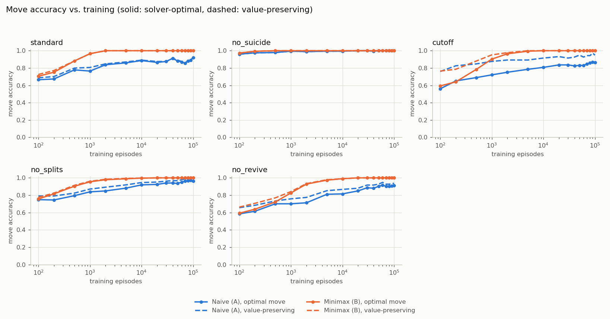
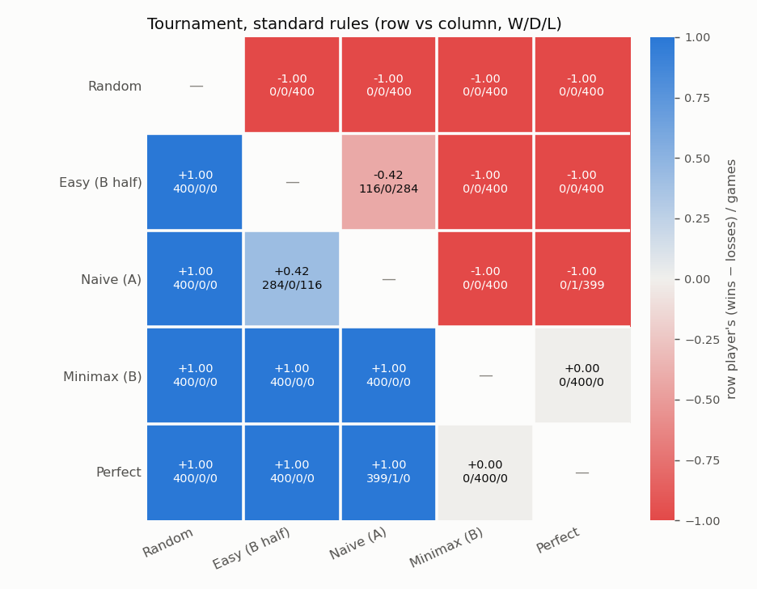

# Chopsticks AI — results

Generated by `python -m chopsticks all`. All numbers come from fixed seeds.

## Solver

| Preset | Rules | Reachable states | WIN | LOSS | DRAW | Start position (first player) |
|---|---|---:|---:|---:|---:|---|
| standard | Sums wrap mod 5 (4 + 4 = 3; exactly 5 is dead). Revives and suicide splits allowed. | 207 | 72 | 35 | 100 | DRAW |
| no_suicide | Like standard, but a split may not leave a hand at 0. | 204 | 25 | 17 | 162 | DRAW |
| cutoff | Like standard, but any hand reaching 5 or more dies (4 + 4 = dead). | 191 | 120 | 61 | 10 | LOSS in 26 plies |
| no_splits | Attacks only; no splits at all. | 200 | 82 | 46 | 72 | DRAW |
| no_revive | Dead hands stay dead; splits only when both hands are alive. | 207 | 91 | 48 | 68 | DRAW |

Distances are in plies (single moves by either player). The solver ignores the move cap, so DRAW means neither side can force a result.

## What we found

- **Suicide splits don't change the result.** Under standard rules the starting position is a DRAW for the first player, and it is still a DRAW with suicide splits banned.
- **cutoff**: start is LOSS for the first player in 26 plies.
- **no_splits**: start is DRAW for the first player.
- **no_revive**: start is DRAW for the first player.
- **Accuracy (mean over presets).** Naive (A): 93.2% optimal, 95.9% value-preserving, 48.9% value agreement. Minimax (B): 100.0% optimal, 100.0% value-preserving, 100.0% value agreement.
- **standard tournament** (W/D/L): A vs Random 400/0/0, B vs Random 400/0/0, A vs Perfect 0/1/399, B vs Perfect 0/400/0.
- **no_suicide tournament** (W/D/L): A vs Random 400/0/0, B vs Random 400/0/0, A vs Perfect 0/400/0, B vs Perfect 0/400/0.
- **cutoff tournament** (W/D/L): A vs Random 400/0/0, B vs Random 400/0/0, A vs Perfect 0/200/200, B vs Perfect 200/0/200.
- **no_splits tournament** (W/D/L): A vs Random 392/8/0, B vs Random 373/27/0, A vs Perfect 0/400/0, B vs Perfect 0/400/0.
- **no_revive tournament** (W/D/L): A vs Random 399/1/0, B vs Random 397/3/0, A vs Perfect 0/110/290, B vs Perfect 0/400/0.

## Agent accuracy vs. the solver

*Optimal move*: the greedy move is one of the solver's optimal moves (fastest win / slowest loss). *Value-preserving*: the move keeps the game-theoretic result (any winning move from a WIN, any drawing move from a DRAW). Ties between equal Q-values count fractionally. *Weighted* versions weight each state by how often it came up in the agent's games against Random and against Perfect. *Value agreement*: sign of max Q (|Q| < 0.05 = draw) matches the solver.

| Preset | Agent | Optimal move | Value-preserving | Optimal (weighted) | Value-preserving (weighted) | Value agreement |
|---|---|---:|---:|---:|---:|---:|
| standard | Naive (A) | 92.2% | 92.2% | 95.9% | 95.9% | 37.8% |
| standard | Minimax (B) | 100.0% | 100.0% | 100.0% | 100.0% | 100.0% |
| no_suicide | Naive (A) | 100.0% | 100.0% | 100.0% | 100.0% | 13.7% |
| no_suicide | Minimax (B) | 100.0% | 100.0% | 100.0% | 100.0% | 100.0% |
| cutoff | Naive (A) | 86.4% | 94.9% | 75.7% | 99.6% | 68.4% |
| cutoff | Minimax (B) | 100.0% | 100.0% | 100.0% | 100.0% | 100.0% |
| no_splits | Naive (A) | 96.2% | 98.4% | 100.0% | 100.0% | 62.9% |
| no_splits | Minimax (B) | 100.0% | 100.0% | 100.0% | 100.0% | 100.0% |
| no_revive | Naive (A) | 91.2% | 93.8% | 95.9% | 98.0% | 61.7% |
| no_revive | Minimax (B) | 100.0% | 100.0% | 100.0% | 100.0% | 100.0% |

## Learning curves

## Why γ < 1: Minimax (B) at γ = 1.0

With γ = 1 a win in 3 and a win in 30 are both worth +1, so the agent has no reason to finish. It keeps every winning position (value-preserving stays at 100%) but can circle among them until the move cap declares a draw. Discounting (γ = 0.95) makes faster wins worth more, which is what the solver's distance-to-result encodes.

| Preset | γ | Optimal move | Value-preserving | vs Perfect (W/D/L) | vs Random (W/D/L) |
|---|---:|---:|---:|---:|---:|
| standard | 0.95 | 100.0% | 100.0% | 0/400/0 | 400/0/0 |
| standard | 1.0 | 99.0% | 100.0% | 0/400/0 | 400/0/0 |
| no_suicide | 0.95 | 100.0% | 100.0% | 0/400/0 | 400/0/0 |
| no_suicide | 1.0 | 100.0% | 100.0% | 0/400/0 | 400/0/0 |
| cutoff | 0.95 | 100.0% | 100.0% | 200/0/200 | 400/0/0 |
| cutoff | 1.0 | 73.9% | 100.0% | 43/157/200 | 362/0/38 |
| no_splits | 0.95 | 100.0% | 100.0% | 0/400/0 | 373/27/0 |
| no_splits | 1.0 | 94.6% | 100.0% | 0/400/0 | 374/26/0 |
| no_revive | 0.95 | 100.0% | 100.0% | 0/400/0 | 397/3/0 |
| no_revive | 1.0 | 91.3% | 100.0% | 0/400/0 | 396/4/0 |

## Tournaments

Each pairing plays the listed number of games, alternating who moves first. Cells are the row player's wins/draws/losses. Easy = the earliest Minimax (B) checkpoint whose optimal-move accuracy is at least halfway between an untrained table and the finished agent.

### standard (400 games per pairing; Easy = 500 of 100,000 episodes)

| row vs column | Random | Easy (B half) | Naive (A) | Minimax (B) | Perfect |
|---|---:|---:|---:|---:|---:|
| **Random** | — | 0/0/400 | 0/0/400 | 0/0/400 | 0/0/400 |
| **Easy (B half)** | 400/0/0 | — | 116/0/284 | 0/0/400 | 0/0/400 |
| **Naive (A)** | 400/0/0 | 284/0/116 | — | 0/0/400 | 0/1/399 |
| **Minimax (B)** | 400/0/0 | 400/0/0 | 400/0/0 | — | 0/400/0 |
| **Perfect** | 400/0/0 | 400/0/0 | 399/1/0 | 0/400/0 | — |

### no_suicide (400 games per pairing; Easy = 100 of 100,000 episodes)

| row vs column | Random | Easy (B half) | Naive (A) | Minimax (B) | Perfect |
|---|---:|---:|---:|---:|---:|
| **Random** | — | 13/0/387 | 0/0/400 | 0/0/400 | 0/0/400 |
| **Easy (B half)** | 387/0/13 | — | 0/321/79 | 0/179/221 | 0/172/228 |
| **Naive (A)** | 400/0/0 | 79/321/0 | — | 0/400/0 | 0/400/0 |
| **Minimax (B)** | 400/0/0 | 221/179/0 | 0/400/0 | — | 0/400/0 |
| **Perfect** | 400/0/0 | 228/172/0 | 0/400/0 | 0/400/0 | — |

### cutoff (400 games per pairing; Easy = 500 of 100,000 episodes)

| row vs column | Random | Easy (B half) | Naive (A) | Minimax (B) | Perfect |
|---|---:|---:|---:|---:|---:|
| **Random** | — | 5/0/395 | 0/0/400 | 0/0/400 | 0/0/400 |
| **Easy (B half)** | 395/0/5 | — | 30/0/370 | 4/0/396 | 4/0/396 |
| **Naive (A)** | 400/0/0 | 370/0/30 | — | 0/200/200 | 0/200/200 |
| **Minimax (B)** | 400/0/0 | 396/0/4 | 200/200/0 | — | 200/0/200 |
| **Perfect** | 400/0/0 | 396/0/4 | 200/200/0 | 200/0/200 | — |

### no_splits (400 games per pairing; Easy = 500 of 100,000 episodes)

| row vs column | Random | Easy (B half) | Naive (A) | Minimax (B) | Perfect |
|---|---:|---:|---:|---:|---:|
| **Random** | — | 6/19/375 | 0/8/392 | 0/27/373 | 0/24/376 |
| **Easy (B half)** | 375/19/6 | — | 0/106/294 | 0/296/104 | 0/296/104 |
| **Naive (A)** | 392/8/0 | 294/106/0 | — | 0/400/0 | 0/400/0 |
| **Minimax (B)** | 373/27/0 | 104/296/0 | 0/400/0 | — | 0/400/0 |
| **Perfect** | 376/24/0 | 104/296/0 | 0/400/0 | 0/400/0 | — |

### no_revive (400 games per pairing; Easy = 1,000 of 100,000 episodes)

| row vs column | Random | Easy (B half) | Naive (A) | Minimax (B) | Perfect |
|---|---:|---:|---:|---:|---:|
| **Random** | — | 11/0/389 | 0/1/399 | 0/3/397 | 0/1/399 |
| **Easy (B half)** | 389/0/11 | — | 21/15/364 | 0/44/356 | 0/40/360 |
| **Naive (A)** | 399/1/0 | 364/15/21 | — | 0/104/296 | 0/110/290 |
| **Minimax (B)** | 397/3/0 | 356/44/0 | 296/104/0 | — | 0/400/0 |
| **Perfect** | 399/1/0 | 360/40/0 | 290/110/0 | 0/400/0 | — |
